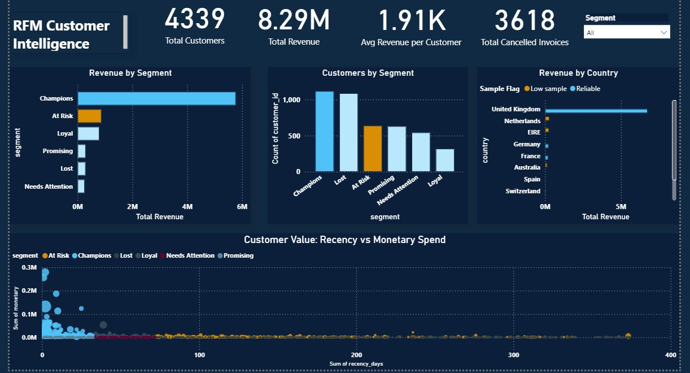
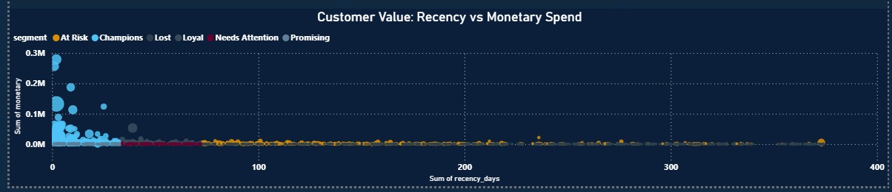

# RFM Customer Intelligence Dashboard — Online Retail

**Tools:** Excel · PostgreSQL (SQL) · Power BI
**Data:** UCI Online Retail dataset, 541,909 transaction rows, Dec 2010–Dec 2011, 38 countries

## Business question

Which customers are most valuable, which are showing signs of churn, and which countries hold the most valuable customer base worth prioritizing for growth?

## Data

- **Source:** UCI Online Retail dataset, transactions from a UK-based online retailer.
- **Size:** 541,909 transaction lines, December 2010 to December 2011, 38 countries, 25,900 distinct invoices.
- **Columns:** InvoiceNo, StockCode, Description, Quantity, InvoiceDate, UnitPrice, CustomerID, Country.
- **Tools:** Excel (first-pass cleaning and checks), PostgreSQL (cleaning, RFM scoring and segmentation, reconciled to the cent against Excel), Power BI (interactive dashboard, reconciled against both).

## Data cleaning decisions

| # | Issue | Rows | Decision | Why |
|---|-------|------|----------|-----|
| 1 | Exact duplicate rows | 5,268 | Removed | Identical on every column, so true duplicates |
| 2 | Zero price, blank description and no CustomerID | 1,454 (after duplicate removal) | Flagged and excluded | Not customer activity; likely stock adjustments |
| 3 | No CustomerID | 135,080 (25% of raw rows) | Kept for total revenue, excluded from customer-level analysis | Cannot be tied to a customer, but the sales were real |
| 4 | Cancellations (InvoiceNo starts with "C") | 9,288 in raw data | Kept; netted out of spend and counted as a churn signal | A customer who buys and cancels is behaving differently |
| 5 | Customers who only ever cancelled | 33 | Excluded from scoring | No purchase to score. Their cancellations may refund orders placed before the data begins (unconfirmed) |
| 6 | Customers with negative net spend | 8 | Kept, given the lowest Monetary score, and flagged | 0.18% of customers; real behaviour; no impact on the groupings |
| 7 | StockCode values that are fees (for example POST) | n/a | Left in | Needed for monetary accuracy |

Result: **4,339 identified customers** scored, with **$8.29M** in net revenue ($8,288,930.66).

## Method: RFM segmentation

- **Recency:** days since the customer's last real purchase, measured from the day after the last invoice in the data.
- **Frequency:** number of distinct orders (distinct InvoiceNo, cancellations excluded).
- **Monetary:** net spend (Quantity x UnitPrice, with cancellations netted out).
- **Scoring:** each measure split into 5 groups using the 20th, 40th, 60th and 80th percentiles. For Recency a small number scores high; for Frequency and Monetary a large number scores high.
- **Frequency ties:** 1,494 customers (34%) placed only one order, so the score-1 group is larger than the others. This is expected in retail data.
- **Value score:** the average of the Frequency and Monetary scores, rounded.

| Segment | Rule |
|---------|------|
| Champions | Recency score 4-5 and value score 4-5 |
| Promising | Recency score 4-5 and value score 1-3 |
| Loyal | Recency score 3 and value score 4-5 |
| Needs Attention | Recency score 3 and value score 1-3 |
| At Risk | Recency score 1-2 and value score 3-5 |
| Lost | Recency score 1-2 and value score 1-2 |

The full SQL (cleaning view, customer table, scoring and segments) is in `/sql/project1_online_retail.sql`. Every step was reconciled against an independent Excel analysis: 4,339 customers, $8,288,930.66 net revenue, and identical customer counts in all six segments.

## Dashboard

Interactive Power BI dashboard built on the segmented customer table. The country chart flags any country with fewer than 15 customers as "Low sample," since a handful of large buyers can distort a small country's average (see the Netherlands/EIRE finding below). Clicking a segment in the slicer filters every chart, including the KPI cards, to that segment alone.

The scatter chart is the clearest single view of the segmentation: Recency (days since last purchase) on the x-axis, Monetary value on the y-axis, dot size by order Frequency, colored by segment. Champions sit high and to the left (recent, high spend); Lost and At Risk spread across the low-value, higher-recency area.

**Design note:** the country chart keeps the United Kingdom in view at full scale rather than excluding it, so the bar lengths understate the gap between Germany, France and the smaller markets. The real comparison between them is in the table in Finding 2 below.

## Findings

### 1. Revenue is concentrated in a quarter of customers

| Segment | Customers | % of customers | Revenue | % of revenue |
|---------|-----------|----------------|---------|--------------|
| Champions | 1,118 | 25.8% | $5,771,814 | 69.6% |
| At Risk | 639 | 14.7% | $871,433 | 10.5% |
| Loyal | 319 | 7.4% | $795,422 | 9.6% |
| Promising | 631 | 14.5% | $296,377 | 3.6% |
| Lost | 1,088 | 25.1% | $293,497 | 3.5% |
| Needs Attention | 544 | 12.5% | $260,386 | 3.1% |

Percentages are of identified customers only. The 135,080 rows with no CustomerID cannot be assigned to a segment.

> Champions are about a quarter of identified customers (25.8%) but generate 69.6% of their revenue, so the business should protect them with loyalty perks such as early access or rewards. The At Risk group, 639 customers who have gone quiet, is the best win-back target: each is worth about $1,364 on average, roughly five times a Lost customer ($270), and the Lost group (25.1% of customers, 3.5% of revenue) is not worth chasing.

Average value per customer: Champion about $5,163, At Risk about $1,364, Lost about $270.

### 2. The UK dominates, but it is not where spend per customer is highest

- The UK holds 90.37% of customers but 81.51% of revenue ($6,756,202), so customers elsewhere spend more each.
- **Germany** (94 customers, $2,357 average) and **France** (87 customers, $2,260 average) are the most reliable growth markets. Their biggest customer is a small share of the total.
- The Netherlands' $31,629 average is misleading: one customer (14646) accounts for 98.2% of its $284,662 revenue, and the typical Dutch customer spent about $464. EIRE shows the same pattern with 3 customers.

> Germany (94 customers, $2,357 average spend) is the most reliable growth market. The Netherlands' $31,629 average is driven by a single customer who accounts for 98.2% of its revenue, so it is better treated as a key account to protect than a market to expand into.

"Unspecified" and "European Community" appear as countries in the data. They are kept in totals and excluded from country rankings.

### 3. A notable edge case

Customer 12346 bought 74,215 units of one item and cancelled the whole order 16 minutes later, leaving net spend of exactly $0. Net spend and engagement can disagree, which is why cancellations were kept in the analysis.

## Recommendations

1. Protect Champions with loyalty perks, and keep an eye on customer concentration risk.
2. Run a win-back offer aimed at the 639 At Risk customers.
3. Put growth spend into Germany and France before the Netherlands or EIRE.
4. Treat customer 14646 (Netherlands) as a key account.

## Limitations

- Data covers one year (2010-2011), so seasonality and long-term trends cannot be judged.
- Customer-level results exclude 25% of transaction rows that have no CustomerID.
- Segments are relative: the groups are quintiles, so a Champion means "top of this customer base", not a fixed spend level.
- Country averages for small markets (fewer than 15 customers) can be driven by one or two buyers.
- A few non-product StockCodes (for example POST) are included in spend.

## What I'd do with more data

- Order-level product data for Champions specifically, to see what they buy and build a targeted upsell list, not just a loyalty perk.
- A second year of data, to tell a real seasonal trend apart from the one-year pattern seen here.
- A support/returns-reason field, to know whether the 8 negative-spend customers are quality complaints rather than ordinary returns.

## Files in this repo

- `project1_online_retail.sql` — full SQL: cleaning view, customer-level RFM table, scoring, segmentation, country summary. Each step includes the expected result it was checked against.
- `images/` — dashboard screenshots.
- Raw and cleaned Excel workbooks (cleaning checks, RFM scoring, country analysis) available on request / linked from the portfolio site.
